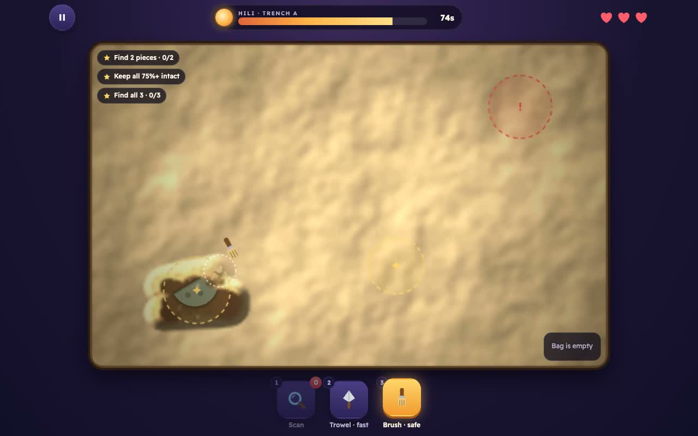
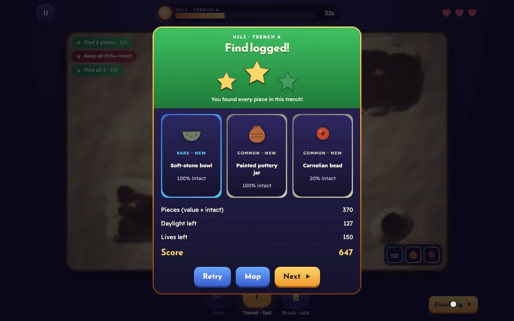

# Biqsha بقشة

A timed archaeology dig game set at five real heritage sites in the UAE. Scan the ground, dig with a trowel or a brush, and recover pieces before the sun sets, without cracking them or getting bitten by a snake.

COSC 452 Human-Computer Interaction, Fall 2026, course project (Phase 2 prototype).

## Play

- **In the browser:** open `index.html` (double-click it, or use the GitHub Pages link if it is enabled).
- **Offline:** download the repo. The game is one HTML file with no build step. Progress is saved in the browser.
- **Gameplay video:** [media/gameplay.mp4](media/gameplay.mp4)

## How it plays

| Tool | Key | What it does |
| --- | --- | --- |
| Scan | 1 | Shows gold rings over buried pieces and red rings over snakes and scorpions. Limited per dig. |
| Trowel | 2 | Fast. Scoops soil, but cracks a piece or wakes a snake if it hits one. |
| Brush | 3 | Slow but safe. Use it when a dark outline shows through the thin soil. |

- **Sites:** Hili (Al Ain), Mleiha, Saruq Al-Hadid, Ed-Dur and Julfar, with 3 digs each (15 levels). The map opens one site at a time.
- **Stars:** find enough pieces, keep every piece 75% intact or better, and find all pieces.
- **Rarity:** Common, Rare, Epic and Legendary. 25 pieces fill the museum.
- **Dangers:** snakes, scorpions and sandstorms. Water flasks add 8 seconds.
- **Leaderboard:** shared online in the hosted version. When offline, scores stay on the device.

## HCI principles applied

- **Visibility of system status:** the sun timer, hearts, star goals and bag stay on screen.
- **Recognition rather than recall:** scan rings stay in place, and objects show through the soil before you reach them.
- **Error prevention and recovery:** the brush is the safe option, and every crack or bite message says why it happened.
- **Consistency with familiar games:** a top resource bar, a bottom tab bar with a central Play button, level popups and a star-based result screen.

## Files

- `index.html`: the whole game.
- `media/`: the gameplay video and screenshots.
